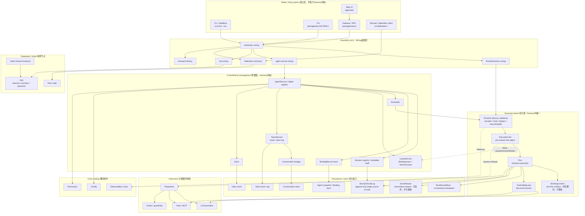
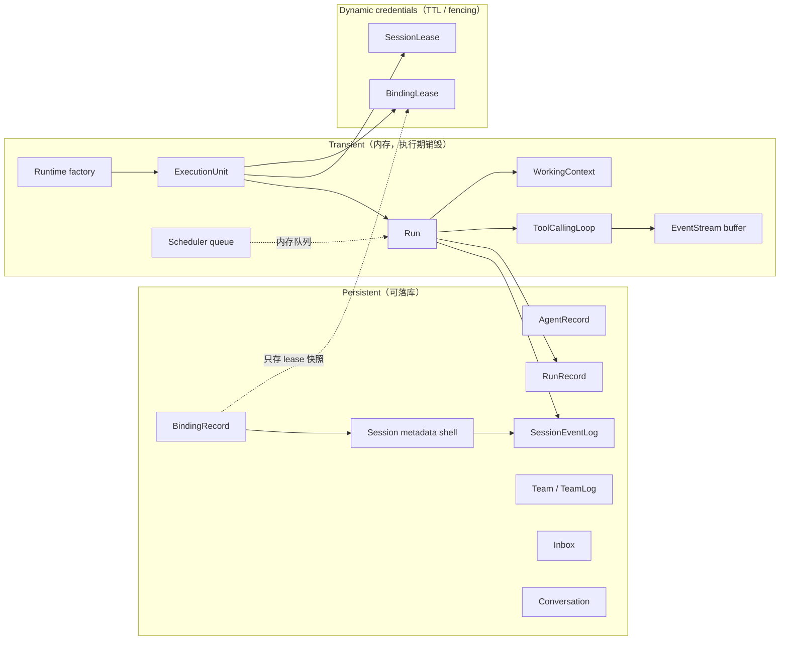
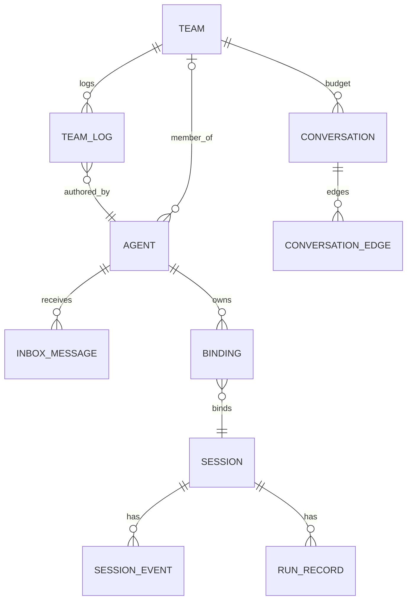

# 目标架构：术语、分层与迁移

> 目标 / 迁移态，非现态。现态以同目录其他架构页与代码为准；决策见 [ADR-098](../adr/ADR-098-terminology-and-layering-agent-session-runtime-loop-run.md)（accepted；tenant 部分已被 ADR-100/T0–T5 取代）。本页随 0.34 Stage 更新，git 历史即版本。
>
> **现状指针（2026-11-09）**：0.34 Stage 4 已落地，迁移已推进到 0.49；本页保留为迁移蓝图。当前事实以 [architecture/INDEX.md](INDEX.md) 的 `current` 页为准。归档前必须逐条确认每个 target 事实已有 current 归宿。

本页完整描述 0.34 的目标模型：五词与附属词、分层与层边界、C1–C4、10 项用户裁决、4 处连线语义、3 条配套铁律、迁移分期与 5 张目标分层图。它是**目标 / 迁移态**文档，不是现态；Stage 落地后由对应的 `current` 架构页承接。

## 1. 五词（冻结）

| 词 | 定义 | 代码落点 | 不拥有 |
|---|---|---|---|
| **Agent** | 持久身份 + 能力档位 + membership/visibility 指针 | `AgentRecord`（原 `MemberRecord`） | 绑定、执行、Session 内容、Run |
| **Session** | 持久对话事实（append-only 事件 + 元数据壳） | `SessionEventLog` + `SessionInfo` | run 状态、绑定、活执行 |
| **Runtime** | 嵌入式执行框架/工厂，provider/tools/plugins/loop 模板，无状态、per-node、不绑定 Session | `Runtime`（无状态工厂，别名 `RuntimeFactory`，Stage 4 落地） | 身份、Session 真相、Binding/lease 真相、调度队列 |
| **Loop** | Run 内的纯函数/闭包，LLM 迭代编排，零策略、无跨 run 状态、不碰持久化 | `ToolCallingLoop` | 身份、lease、持久化、调度、Session 生命周期 |
| **Run** | 一次执行，瞬时对象 + 增量 checkpoint 的 `RunRecord`，拥有 `WorkingContext` | `Run` + `RunRecord`（原 `RunCheckpoint`） | Session 内容、活状态、Loop 内部态 |

五词是外部口径，但**不在同一抽象层级**：`Agent` / `Session` 是持久实体，`Runtime` 是无状态工厂，
`Loop` 是 Run 内部的实现细节，`Run` 是一次执行。四类对象生命周期、归属与持久化边界各不相同，
**不得互相平替**——把框架当活对象、把活执行当持久实体、把 Loop 当可替换策略层，都会重新引入
「谁拥有 `WorkingContext`」「谁写 `SessionEventLog` / `RunRecord`」「Run 能否访问租约」这三处歧义。

## 2. 附属词（不进五词）

| 词 | 定义 |
|---|---|
| **ControlPlane** | 管理面：Agent / Session / Binding / Team / Inbox / Conversation 生命周期、准入、路由、Scheduler、LeaseService |
| **BindingRecord** | Agent ↔ Session 的 durable 绑定：epoch / primary / retired / 历史；**不持有有效、可用于续租的活跃租约**；仅留存 leaseId 与最后 renew 快照用于审计追溯 |
| **ExecutionUnit** | per-session 活执行对象（原 `AgentRuntime`）；持有 Session 引用、只读事件句柄、lease 句柄、`activeRun`、abort |
| **WorkingContext** | Run 从 `SessionEventLog` 生成的可重建窗口（消息切片、token 预算、压缩标记、检索游标）；**per-run 瞬时，不落库** |
| **LeaseService** | 单节点本地租约服务；颁发/续租/回收 `BindingLease` + `SessionLease`；租约带 tenant 标签 |
| **Scheduler / PluginHost / Inbox / Team / Conversation** | 保留原名与职责，不因本架构改名 |

## 3. 分层细则

```text
Shells（CLI / TUI / WebUI / Gateway / Remote）
  → Assembly（src/ 唯一装配点）
    → ControlPlane（Agent / Session / Binding / Team / Inbox / Conversation / Scheduler / LeaseService）
      → Runtime（无状态工厂，per-node）
        → ExecutionUnit（per-session 长活）
          → Run（per-execution 瞬时）
            → ToolCallingLoop（Run 内闭包）

Persistence：SessionEventLog（唯一真相）· RunRecord（增量 checkpoint）· EventStream（观察，可丢弃）
Extensions：PluginHost → providers / tools / hooks / MCP
Federation / Node：Node（部署实例）· Hub（顶层全局目录/指针）· Federation（node→node team 投递）
Cross-cutting：Config · Permission · Observability
Tenant：数据隔离标签，渗透服务/存储，不画成组件
```

- **Persistence**：`SessionEventLog` 是唯一 append-only 真相源；`RunRecord` 是 run 的增量
  checkpoint（状态 / token / 游标 / 错误）；`EventStream` 只是观察流，可丢弃、不可重放，不得作为
  恢复依据。
- **Extensions**：`PluginHost` 是全局插件 / 工具 / 护栏注册中心，向下供给 providers、tools、
  hooks 与 MCP；插件不感知 Run 内部状态。
- **Federation / Node**：Node 是 Vessel 部署实例，`node_id` 是寻址键；Hub 是独立顶层全局目录
  （目录 / 配对 / 指针 / presence），不代理正文、不做业务授权；Federation 是 node→node 的 team
  消息投递。
- **Cross-cutting**：Config / Permission / Observability 横切所有层，不作为某个层的子组件。
- **Tenant**：数据隔离标签，渗透所有服务与存储；它不是组件，任何架构图都不得把它画成节点。

## 4. 10 条层边界

1. **Gateway = Shell/Entrypoint 适配器**；transport 在 Assembly；Gateway 不含执行逻辑。
2. **Hub = 独立顶层全局目录服务**；不属于单节点 ControlPlane；不代理正文、不做业务授权。
3. **Node = Vessel 部署实例**；`node_id` 是寻址键；Tenant 是隔离标签。
4. **Team / Inbox / Conversation = ControlPlane 托管的领域聚合**；Execution plane 不感知 Team。
5. **WebUI → Gateway**；TUI/CLI 可进程内直连 bootstrap；远程/跨节点强制 Gateway。
6. **ExecutionUnit per-session 长活**；同一 Session 多次 Run 复用 EU；Run 瞬时。
7. **Runtime per-node 无状态**；Node 内多 tenant 共享。
8. **LeaseService per-node 本地**；租约带 tenant 标签；跨节点迁移靠旧租约过期。
9. **Federation 入站强制经过本节点 ControlPlane admit**（权限 / team / tenant / 防重放），之后才写
   Inbox / Team 日志。
10. **WorkingContext 只读当前 SessionEventLog**；跨 Session 记忆是独立插件，不进主链路。

## 5. C1–C4（完整解释）

| # | 决策 |
|---|---|
| **C1** | **RunRecord 增量 checkpoint**：run 开始写 `status=running`；LLM/工具安全点更新 `event_cursor / iteration / usage`；结束 finalize。`WorkingContext` 不落库，resume 从 `SessionEventLog` + cursor 重建。 |
| **C2** | **两级 lease**：`BindingLease`（binding_id，ControlPlane 授权 / LeaseService 颁发 / EU 持有并续租，归属保活）→ `SessionLease`（session_id，EU 在 Run 前获取，独占/append fencing）。顺序 binding → session；EU retire 时逆序释放；Run 不访问 LeaseService；读路径不需要租约。 |
| **C3** | **`ToolCallingLoop` = Run 内纯函数/闭包**：不导出、无策略、不持租约/持久化；复杂时可降级为 Run 内局部类，禁止提升到 EU 方法。 |
| **C4** | **`AgentRuntime` 整体改名 `ExecutionUnit`**；新建 `Runtime`（`RuntimeFactory`）无状态工厂；代码中不再出现 `AgentRuntime`。 |

C1 之所以把 checkpoint 前置到 run 开始，是因为「durable run / run 可 resume」这一既有口径要求
crash 后能找到 run 记录；只在结束时写与 resume 直接冲突。C2 的授权者（ControlPlane）与持有者
（EU）分离，是「Run 不接触 LeaseService」得以成立的前提：Run 只收到 EU 注入的 fencingToken。

> **Stage 3 补充约束（用户 2026-11-01）**
>
> 1. `restart` / `compactFork` 遇 active run 返回 `conflict`，payload 必须带
>    `run_id` / `session_id` / `lease_token`（当前 SessionLease 的 fencingToken；无则 `null`）。
> 2. `compactFork` 完成后旧 primary EU retire/dispose；旧 SessionLease 释放，失败靠 TTL 过期兜底；
>    新 primary 的 lease fence 必须高于旧；旧 token 写 `SessionEventLog` / `RunRecord` 被
>    `token >= currentFence` 拒绝；旧 primary 有 active run 时同样返回 `conflict`。
>    「父 Session / binding 不动」只指 durable 数据不被改写，不表示旧 EU / lease 继续持有。
> 3. 生命周期事件统一带 `epoch` + `fencing_token`：`agent.restarting` / `agent.restarted` /
>    `agent.compact_forked`，既有 `agent.rotating` / `agent.rotated` additive 补字段；事件名不改。
> 4. `FileLeaseService` **仅单节点本地** `.locks/leases/**`，不做多节点 / 集群共识；
>    跨节点迁移 / 接管靠 TTL 过期 + fencing，不得当作分布式锁使用。

> **上下文 v2 补充（0.34）**
>
> 手动 `/compact`（本地 live EU 或 idle 瞬态路径）是 **Session 级控制操作**：写
> `message.compaction`（含 cleared ids / degraded）与 `SessionState`，**不写 `RunRecord`、
> 不启动 Run**。它是对「正常执行路径 Run 唯一写者」的显式受控例外，与 run 级执行写者隔离。

## 6. 10 项用户裁决

| # | 裁决 | 内容 | 对应层边界 |
|---|---|---|---|
| 1 | **Gateway = Shell** | Gateway 是 Shell/Entrypoint 适配器；transport 在 Assembly；Gateway 不含执行逻辑。 | 层边界 1：接入层只做适配，执行逻辑在内核。 |
| 2 | **Hub 独立** | Hub 是独立顶层全局目录服务，不属于单节点 ControlPlane；不代理正文、不做业务授权。 | 层边界 2：目录面与单节点管理面分离。 |
| 3 | **Tenant 不画** | Node 是 Vessel 部署实例，`node_id` 是寻址键；Tenant 是隔离标签，不画成组件。 | 层边界 3：隔离标签渗透服务/存储，不是节点。 |
| 4 | **Team 领域聚合** | Team / Inbox / Conversation 由 ControlPlane 托管；Execution plane 不感知 Team。 | 层边界 4：管理面聚合，执行面不可见。 |
| 5 | **TUI 可进程内** | WebUI → Gateway；TUI/CLI 可进程内直连 bootstrap；远程/跨节点强制 Gateway。 | 层边界 5：进程内直连是 Shell 的合法路径。 |
| 6 | **EU 长活** | ExecutionUnit per-session 长活，同一 Session 多次 Run 复用；Run 瞬时。 | 层边界 6：活对象与单次执行分层。 |
| 7 | **Runtime per-node** | Runtime 无状态；Node 内多 tenant 共享。 | 层边界 7：框架层不属于任何 Session/tenant。 |
| 8 | **LeaseService per-node** | LeaseService 本地；租约带 tenant 标签；跨节点迁移靠旧租约过期。 | 层边界 8：凭证服务本地化，不跨节点共享状态。 |
| 9 | **Federation 过 admit** | 入站强制经本节点 ControlPlane admit（权限 / team / tenant / 防重放），之后才写 Inbox / Team 日志。 | 层边界 9：联邦入站不能绕过管理面。 |
| 10 | **WorkingContext 仅当前 Session** | 只读当前 `SessionEventLog`；跨 Session 记忆是独立插件，不进主链路。 | 层边界 10：窗口来源唯一，跨会话记忆在插件层。 |

## 7. 4 处连线语义

1. **Loop 不碰持久层**：`LOOP → RUN` 交还 facts / usage；`RUN → SessionEventLog` 追加事实、
   `RUN → RunRecordStore` 写 checkpoint；`LOOP → EventStream` 只发 observation。
   **`SessionEventLog` / `RunRecord` 的正常执行路径唯一写者 = Run**；ControlPlane 生命周期转移
   （`queued → cancelled`、`running → interrupted`）是受控例外，见 8.3 补充。
2. **EU → SessionEventLog 只读**：EU 只持 session 引用 / 只读句柄；不追加事实、不写 checkpoint。
3. **租约链路**：ControlPlane 授权 → LeaseService 颁发 → ExecutionUnit 持有并续租；Run 不接触
   LeaseService；`RunRecord` 记 `fencingToken`，由 EU 启动 Run 时注入。**fencingToken 来自 EU
   当前持有的有效 SessionLease**，不是 Run 自行生成。
4. **联邦逻辑边 vs 物理边**：图中 `TeamService A ↔ TeamService B` 是**逻辑边**；物理路径 =
   `TeamService A → federation client → Gateway B → ControlPlane B admit → TeamService B`。

## 8. 3 条配套铁律

1. **持久端口注入顺序**：`PersistencePorts` 只注入 Runtime 工厂层和 Run；EU 只拿只读 EventLog
   句柄；Loop 不注入任何 `PersistencePort`。
2. **租约依赖隔离**：`LeaseService` 只被 ControlPlane 和 ExecutionUnit 引用；Run / Loop / Plugin
   不得持有 `LeaseService`。
3. **逻辑边 vs 物理边**：跨节点连线默认是业务逻辑边；文档必须标注真实物理路由，禁止把逻辑边
   当作进程直连。

> 补充：所有 fencing 校验点（写 `SessionEventLog`、写 `RunRecord`）只校验 `fencingToken`，
> 不主动触发租约续租；续租是 EU 独立后台循环任务，和 Run 执行解耦。

> 补充：正常执行路径的唯一写者 = Run；ControlPlane 的 `queued → cancelled`、`running → interrupted`
> （liveness 修复）是显式受控例外，只允许状态/错误字段，不写 usage/iteration/cursor；
> `ask-channel` 恢复的 `user.message` 改由 `resumeRun` 内部追加，回到单写者。

## 9. 迁移分期（Stage 0–4）

| Stage | 内容 | 行为变化 |
|---|---|---|
| **0** | ADR-098 + 旧 ADR 的 Errata + 架构页迁移指针；术语表 / 分层 / C1–C4 / 10 项层边界 / 4 连接语义 / 3 铁律 | 无（纯文档） |
| **1a** | 纯改名：`AgentRuntime → ExecutionUnit`、body → `BindingRecord`；**不含 Runtime / RuntimeFactory**；不移动文件职责、不抽逻辑 | 无 |
| **1b** | 抽 `ToolCallingLoop`（Run 内闭包） | 无（等价搬移） |
| **2** | 类型拆分：`RunState` → Session 元数据 + `RunRecord`；`SessionBackend` 拆端口；`ContextManager` → `WorkingContext`；resume 拆词 | 有 |
| **3** | 生命周期：rotate / restart / compactFork / fork；两级 lease；`serialKey` → `session_id` | 有 |
| **4** | Runtime 框架化：新增 `Runtime`（无状态工厂，别名 `RuntimeFactory`）；Runtime 与 EU 分离、`WorkingContext` per Run、成员 run durable | 有 |

Stage 1a 是纯符号改名：只动源码符号，不动文件职责。`Runtime` / `RuntimeFactory` 是职责迁移
（要把 provider / tools / plugins / loop 模板从 `ExecutionUnit` 搬出），因此从 Stage 1a 移入
Stage 4（Stage 1a PLAN Q1 已批准）；Stage 4 之前代码中不新增这两个实体。

0.34 顺序：Stage 0 → 1a → 1b → S2 → S1 → S5；0.35 续 Stage 2 → 3 → 4 与上下文 v2 B。

**wire / 磁盘 / 事件名不变**：`session_id` / `run_id` / `body_id`（过渡期保留作为存储主键；
源码类型改名为 `BindingRecord`，外部 wire 标识不变）/ `run.*` / `runtime.notice` 全部保持；
**Stage 1a 不做任何 schema / 协议变更**，改名只发生在源码符号层。
**存储键不变，源码类型名变**：不要误以为要改数据库索引或 wire 字段。

## 10. 目标分层图（5 张）

> 以下图描述**目标 / 迁移态**，不是现态；现态以同目录其他架构页与代码为准。
> 图只服务本页的分层与连线语义，不表示对应代码已经落地。

### 10.1 分层与组件



### 10.2 持久 / 瞬时 / 动态凭证



### 10.3 Run 执行时序

```mermaid
sequenceDiagram
  participant U as User (TUI/Web/CLI)
  participant G as Gateway / Assembly
  participant CP as ControlPlane
  participant S as Scheduler
  participant L as LeaseService
  participant R as Runtime (factory)
  participant EU as ExecutionUnit
  participant RUN as Run
  participant LOOP as ToolCallingLoop
  participant SEL as SessionEventLog
  participant RR as RunRecordStore
  participant ES as EventStream

  U->>G: input (session_id, message)
  G->>CP: admit(agent, session, message)
  CP->>S: submit(serialKey=session_id)
  S->>R: execute when ready
  R->>EU: get_or_create ExecutionUnit(binding, session)
  alt 首次创建 ExecutionUnit
    EU->>L: acquire BindingLease + SessionLease
    L-->>EU: leases + fencingToken
  else 复用已有 ExecutionUnit
    note over EU,L: 复用有效 leases；后台续租，不在单条消息 / Run 链路申领
  end
  EU->>RUN: start (status=running)
  RUN->>RR: write RunRecord (start)
  RUN->>SEL: read current transcript
  RUN->>RUN: build WorkingContext (retrieve/compact/truncate)
  RUN->>LOOP: run(WorkingContext, provider, tools, eventSink)
  loop until stop / abort
    LOOP->>RUN: iteration result (facts/usage)
    RUN->>SEL: append facts (SessionLease token)
    RUN->>RR: checkpoint (cursor/iteration/usage)
    LOOP->>ES: publish observation
  end
  LOOP-->>RUN: final result
  RUN->>RR: finalize RunRecord
  RUN-->>CP: result
  CP-->>U: stream / final
```

### 10.4 Hub 与跨节点 Federation

```mermaid
flowchart LR
    subgraph NODE_A["Node A (Vessel instance)"]
      GA["Gateway A"]
      CPA["ControlPlane A"]
      EA["ExecutionUnit / Run A"]
      SA["SessionEventLog A"]
      TA["TeamService A"]
    end

    subgraph HUB["Hub（app 层目录控制面，全局）"]
      DIR["Directory: nodes / teams / agents"]
      PAIR["Pairing / tokens"]
      PTR["Pointers / presence"]
    end

    subgraph NODE_B["Node B (Vessel instance)"]
      GB["Gateway B"]
      CPB["ControlPlane B"]
      EB["ExecutionUnit / Run B"]
      SB["SessionEventLog B"]
      TB["TeamService B"]
    end

    subgraph CLIENTS["Clients"]
      WEBA["Web UI A"]
      WEBB["Web UI B"]
      TUIA["TUI A"]
    end

    WEBA --> GA
    WEBB --> GB
    TUIA --> GA
    GA <-->|hub control WSS| HUB
    GB <-->|hub control WSS| HUB
    GA -->|federation data plane: team message (inbound via CP admit)| GB
    CPA --> DIR
    CPB --> DIR
    TA <-->|team federated messages（物理经 Gateway + CP admit）| TB
    HUB -.->|不代理正文 / 不做业务授权| GA
    HUB -.->|不代理正文 / 不做业务授权| GB
```

### 10.5 Team / Inbox / Conversation 实体关系



## 11. 效力边界

- 本页描述**目标 / 迁移态**，不是现态；**其它架构页描述当前现态；本页是目标迁移蓝图，Stage 落地后，对应现态架构页同步更新。**
- 决策记录见 [ADR-098](../adr/ADR-098-terminology-and-layering-agent-session-runtime-loop-run.md)（accepted；tenant 部分已被 ADR-100/T0–T5 取代）；本页不 supersede 任何 ADR。
- 本页随 0.34 Stage 更新，git 历史即版本；不写「已实现」叙事。
