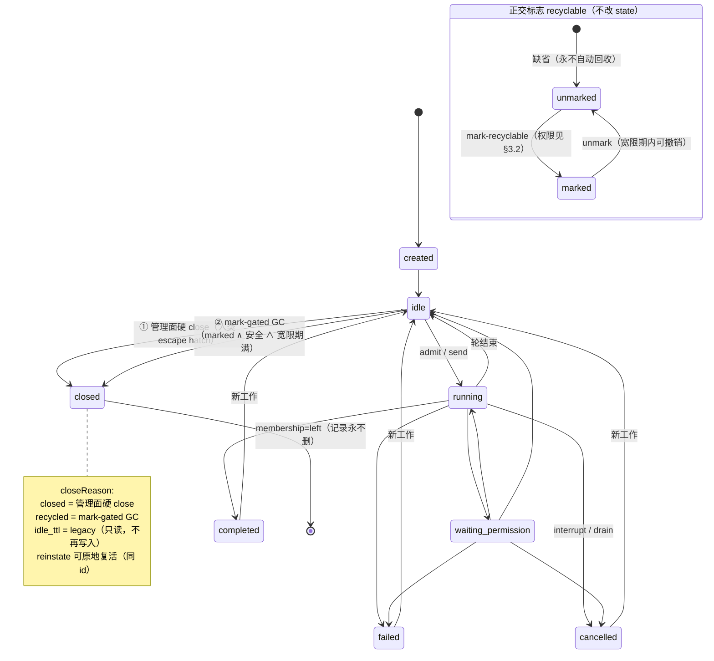

# Agent 生命周期重构设计（mark-gated 回收 + 持久保留）

- 状态：草案（设计中，纯文档，不含代码改动）
- 分支：`design/q-agent-lifecycle`
- 作者：q-agent-lifecycle（parent: main）
- 日期：2026-07-17
- 读者：main / 人类裁决者 / 后续实现者

## 0. 摘要与用户提案（不可违背的四原则）

用户提案原文语义：

1. **所有 agent 都保留**——不因关机 / 重启释放任何 agent；
2. **agent 工具只能中断（interrupt），不能立即清理 agent**；
3. **只能标注「是否可回收」**（mark-recyclable）；
4. **清理由系统自动回收，且只有标注可回收的才能回收**（mark-gated GC）。

本设计在现有代码基础上扩展（非从零建）：`member` / `temporary` 双角色、
`reinstate` 原地复活、durable inbox、`closedAt` / `closeReason` 审计字段全部复用。
核心变更一句话：**把「立即销毁权」从 agent 工具收走，换成「标注权」；把「按 TTL
自动销毁」换成「按标注 + 安全互锁 + 宽限期自动回收」；重启不再释放 temporary。**

## 1. 现状分析（代码事实）

以下锚点均已在分支 `design/q-agent-lifecycle` 的工作树中逐条核对
（行号为撰写时快照，实现时以符号名为准）。

### 1.1 角色与归属

`packages/agent/src/types.ts:55`：`AgentRole = 'member' | 'temporary'`（0.28 收窄为两值）。

| 角色 | 工具入口 | owner | parent | Team | 可见性 | TTL |
| --- | --- | --- | --- | --- | --- | --- |
| `member`（peer） | `agent create` | self（恒等于自身 id） | 无（落盘拒绝） | 必须 | 强制 team | 无，永不自动回收 |
| `temporary`（承包） | `agent hire` | 雇佣者（缺省人类） | 缺省 owner | 可选 | 缺省 team（有 Team）/ private（unbound） | `temporaryTtlHours`，缺省 2h |

- `main` 也是 `member`（`src/agent-service-wiring.ts` `createOrRestoreOwner`）。
- 角色映射：`service.ts:1304`「peer → member（owner=self）；contractor / 无 kind →
  temporary（owner=雇佣者）」。
- Team 内 present 成员上限 `TEAM_MEMBER_LIMIT = 20`（`service.ts:179`，peer +
  contractor 都计入）——持久保留后这是第一个要撞的墙，见 §8.1。

### 1.2 状态机与「释放」的表示

`types.ts:33` `MemberState`：`created / idle / running / waiting_permission /
completed / failed / cancelled / closed / stale(legacy read-only)`。
转移表在 `registry.ts:109` `TRANSITIONS`；`closed` 是吸收态（出边为空）。

「已释放」不是独立状态字段，而是两个持久字段的析取（`service.ts:394`）：

```ts
function isReleased(record) {
  return record.membership === 'left' || record.state === 'closed';
}
```

- `membership: 'present' | 'left'`（持久化）；roster（`agents.list`）只放 present。
- `presence: 'live' | 'gone'`（**进程内，不持久化**）：gone = 需要 resume，不是释放。
- 0.53 起释放审计落盘：`closedAt` / `closeReason`（`registry.ts:104`，
  `types.ts` `PersistedAgentRecord.closed_at / close_reason`）。
- 释放原因两种（`service.ts:388`）：`closed` = 显式 close（人 / 父级 / 批量）；
  `idle_ttl` = sweep 空闲回收。历史视图（`listReleasedMembers`，`includeReleases`）
  只展示记录里写着的事实，未知原因字符串原样保留——**这为新增原因值留好了口子**。
- 记录永不删：「已释放成员的记录永不删」（`registry.ts:101` 注释）；body 记录保留并标
  `retiredAt`，`body_id ≡ session_id` 是续接历史的唯一钥匙（`registry.ts:56`）。

### 1.3 两条释放路径

**路径 A：显式 close**（`service.ts:6319` `close` / `:6355` `closeOne`）

- 批量幂等：`members[]` 逐条 `Promise.allSettled`，重复 close 返回 `{state:'closed'}`，
  单条失败不影响其它条目；gateway `agents.close`（`packages/serve/src/gateway/methods/agents.ts:1345`）
  同语义，team-scoped token 只能关同 team。
- 动作：`disposeAgentBodies`（退役全部 body）→ `state='closed'` + `membership='left'`
  + `presence='gone'` → 写 `closedAt/closeReason='closed'` → 发 `agent.closed` 事件。
- **级联**：owner 被 close 后，其 private temporary 子成员按 registry 原始记录级联
  close（`service.ts:6375-6396`）——这是「立即销毁权」的放大器，重构必须一并收走。
- 权限（`tool.ts:567` `checkPermission`）：owner 调用 / self-close 放行；temporary
  由雇佣者或同 Team 成员放行；**member（含 main）需要人类审批（ask）**，批量含
  member 整体 ask 一次。

**路径 B：sweep 空闲回收**（`service.ts:4374` `sweepIdleTemporaries`）

- 节奏：`clamp(ttl/10, 60s, 15min)`（`service.ts:381/4434`）；定时器只在装配层
  （`src/agent-service-wiring.ts:484-495`，`.unref()`）。TTL=0 关闭。
- 判据读**持久化**字段 `max(record.lastSeen, body.lastActiveAt)`（冷启动后没有内存
  entry 也能触发——这既是优点也是 §1.4 的根因）。
- 只回收 `role==='temporary' && membership==='present'`；member（含 main）永不回收。
- 安全互锁已有雏形：`hasNonIdleWork`（`service.ts:4394`）——在跑轮 / 排队消息 /
  pending / 权限等待一律跳过。
- 动作复用 `reclaimAgent`（`service.ts:4410`）：退役 body + `left/closed` +
  `closeReason='idle_ttl'` + `agent.closed` 事件。**不新增持久字段**。

### 1.4 重启丢全部承包 agent 的根因

关机 / 重启链路（均已核对）：

1. **shutdown drain**（`src/bootstrap.ts:2206-2254`）：fence 准入 → 给有在跑 run 的
   会话写 resume 标记 → `interrupt('shutdown')`。在途 run 被打断，WIP 靠 resume 标记
   与 durable inbox 保全；这一步**没有**释放成员。
2. **loadSnapshot**（`service.ts:1063`）：非 left 成员一律恢复为 `idle + gone`
   （engine 状态进程内易失，`recordFromStatus` `service.ts:711`）。temporary 记录
   **本身是被恢复的**——快照层没有丢。
3. **根因在重启后的第一次 sweep**：判据读的是持久化的
   `max(lastSeen, body.lastActiveAt)`，而**关机时长被计入 TTL**。缺省 TTL=2h，
   只要停机超过 2h（或成员本就空闲超 2h），重启后第一个 sweep tick（≤15min 内）
   就把所有空闲 temporary 判成 `idle_ttl` 回收。对模型侧的表现 = 「本次关机丢全部
   承包 agent」。
4. **复活通道存在但模型够不着**：`reinstate`（`service.ts:6700`）能原地复活
   （同 id、unretire body、清 `closedAt/closeReason`、刷新计时基准），但它「只由
   roster 管理调用」，agent 工具没有入口。于是实践中只能重新 `hire` → 新 id、
   新会话，旧历史挂在已释放记录上不可续接——这就是重雇丢 id/历史的痛点。

结论：**要修的不是快照层（记录本来就在），而是 (a) sweep 的无标注自动销毁权、
(b) 工具层的立即销毁权、(c) 模型侧缺一条「同 id 再激活」的路。**

### 1.5 可复用资产（扩展而非重建的地基）

| 资产 | 锚点 | 在本设计中的用途 |
| --- | --- | --- |
| `reinstate` 原地复活 | `service.ts:6700` | 已释放成员的管理面复活通道，保留不动 |
| 惰性重建 ExecutionUnit | `service.ts:1061` 注释 / admit 路径 | dormant 成员再激活 = 首次 admit 惰性重建，**无需新机制** |
| durable inbox + `recoverPendingInputs` | `service.ts:3783`，`RECOVER_MAX_SESSIONS=8` | 重启后未读消息恢复；GC 互锁要查它 |
| `closedAt/closeReason` additive 审计 | 0.53，`registry.ts:104` | 直接扩展原因值 + 新增标注审计字段 |
| `agent.closed` 事件 + reason | `service.ts:4425` | 回收审计复用，不新增事件类型（标注/撤销除外） |
| `includeReleases` 历史视图 | `service.ts:6779` | 已回收清单的现成展示通道 |
| `hasNonIdleWork` 互锁 | `service.ts:4394` | mark-gated GC 的安全判据基础 |
| `send interrupt:true` | `tool.ts:493` / gateway `agents.send` | 保留为 agent 工具唯一的「停止」手段 |
| bindingHistory / bodies[] 永不删 | `registry.ts:56/66` | 回收后会话历史续接的钥匙 |

## 2. 目标语义与状态机

### 2.1 规范条款（MUST / SHOULD / MUST NOT）

- **M1 持久保留**：关机 / 重启 / drain MUST NOT 释放任何成员（含 temporary）。
  重启后成员以 dormant 形态保留：`membership='present'`、`state='idle'`、
  `presence='gone'`，id / 会话历史 / inbox 全部不变。
- **M2 工具无销毁权**：agent 工具 MUST NOT 提供任何立即销毁成员的入口。
  `agent close` 动作替换为 `mark-recyclable`；级联 close 一并废除（§3.1）。
- **M3 中断保留**：`agent send interrupt:true` 是 agent 工具唯一的「停止」手段：
  取消目标活动 run、保全 WIP（resume 标记 + durable inbox），不改 membership。
- **M4 标注正交**：`recyclable` 是持久化布尔标志 + 审计三元组，**不是新状态**；
  标注 / 撤销不改 `state / membership / presence`，不发终态通知。
- **M5 mark-gated GC**：系统 sweep MUST 只回收 `recyclable===true` 且通过安全互锁
  （§4.2）且宽限期已满（§4.3）的成员。未标注成员 MUST NOT 被自动回收——
  **TTL 到期不再是回收理由**。
- **M6 审批不降级**：标注 peer（`role='member'`）MUST 走人类审批（ask），
  其中 `main` 绝对保护（直接 deny，连 ask 都不给）；标注调用者自身 MUST 拒绝
  （完成信号由雇佣者标注或自动标注策略表达，防注入自毁，§3.2）。
  GC 执行已获批标注时不再二次审批（审批点在标注，见 §3.2 裁决）。
- **M7 可撤销**：宽限期内任何有权限的主体可 `unmark` 撤销标注；撤销即退出待回收
  清单，GC 永不回收。已回收成员走 `reinstate` 复活（同 id）。
- **M8 审计完整**：标注（谁 / 何时 / 为何）与回收（时刻 / 原因）MUST 落盘并进
  事件流；历史视图原样展示，不按白名单改写（沿用 0.53 口径）。

### 2.2 关键设计决策：recyclable 是正交标志，不是新状态

**决策**：不新增 `MemberState` 值（不加 `dormant` / `recyclable` / `recycled` 状态），
只新增持久化标志字段。理由：

1. `MemberState` 表达的是**执行相位**（created→idle→running→…→终态），由
   `updateAgentState` 从 ExecutionUnit 聚合推导（`service.ts:4319`）。把「可回收」
   塞进状态机会让推导逻辑分叉：一个 idle 成员可能同时可回收 / 不可回收，状态机
   无法表达这种正交性，除非状态数乘积爆炸（`idle_recyclable` / `completed_recyclable`…）。
2. `TRANSITIONS`（`registry.ts:109`）是封闭表，新增状态要改全部转移边与
   `canTransition` 调用点；正交标志零侵入。
3. 现有「释放」本来就是 `membership + state` 的析取投影（§1.2），不是状态枚举值——
   沿用同一风格：**回收 = `left/closed` + `closeReason='recycled'`**，
   **dormant = `present + idle + gone`**，都是投影，不是新状态。
4. 快照兼容：additive 字段旧快照读作缺省（`recyclable` 缺省 false），
   `snapshot.ts` 的「绝不在 parse 阶段 reject」铁律自然满足。

新增持久字段（`MemberRecord` / `PersistedAgentRecord`，全部 additive）：

```ts
// registry.ts MemberRecord（camelCase）
recyclable?: boolean;      // 缺省 undefined ≡ false：未标注 = 永不自动回收
markedBy?: string;         // 标注者 principal（agent id / 'human' / 'system'）
markedAt?: number;         // 标注时刻（宽限期计时基准）
markReason?: string;       // 标注理由（必填，单行截断 500 字符，同闸原因口径）

// types.ts PersistedAgentRecord（snake_case 落盘）
recyclable?: boolean;
marked_by?: string;
marked_at?: number;
mark_reason?: string;
```

`recyclable` 缺省 false 是**安全缺省**：旧快照 / 迁移期成员一律不可自动回收，
宁可 roster 增长也不误杀（§8.1 的墙用显式标注 + GC 疏解，不用缺省 true）。

### 2.3 状态机图

执行相位状态机**不变**（沿用 `TRANSITIONS`）；标注是正交维度，回收是释放投影：



要点：

- 图中 ② 只从 `idle` 出发是简化：GC 的安全互锁（§4.2）保证回收时刻成员必然
  无在途工作，聚合态必为 idle / 终态之一；终态成员同样可被回收（先经
  `updateAgentState` 归 idle 或直接按终态处理，实现时统一走 `reclaimAgent`）。
- `running / waiting_permission` 成员**可以被标注**（标注不打断），但 GC 会一直
  跳过直到安全；需要立刻停下时先 `interrupt` 保全再等 GC——这正是用户提案
  「先 interrupt 保全再标注」的操作序。
- `stale` 保持 legacy read-only，不新增写入者。

### 2.4 dormant 语义与再激活（同 id，非重雇）

- **dormant 不是新状态**：= `present + idle + presence:'gone'`。重启后所有成员
  （含 temporary）都以此形态恢复（`loadSnapshot` 现有行为，§1.4 第 2 步），
  本设计只是**不再让随后的 sweep 把它们销毁**。
- **再激活 = 首次 admit 惰性重建 ExecutionUnit**（现有机制，`service.ts:1061`）：
  任何 `agent send` / 人类投递到 dormant 成员 → admit → `ensureExecutionUnit`
  重建 runtime → 同一 `binding_id ≡ session_id` 续接会话历史。**id 稳定，
  无需重新 hire，无需新 API。**
- 已释放（`left/closed`）成员的复活仍走 `reinstate`（管理面 / roster 通道，
  同 id unretire）。本设计不新增模型侧复活入口：GC 回收的成员若需复活，
  由人类 / roster 管理操作——避免模型绕过标注语义私自「复活再回收」打转。
- 重启恢复的 spawn 成本仍由 `RECOVER_MAX_SESSIONS=8` 封顶（`service.ts:349`）：
  dormant 保留是**记录级**的，不是一开机全部拉起；超出顺延下次启动。

### 2.5 释放原因扩展与审计轨迹

`closeReason` 值域扩展（历史视图原样展示，无需白名单改动）：

| reason | 写入者 | 语义 |
| --- | --- | --- |
| `closed` | 管理面硬 close（人类 RPC，保留） | 显式立即关闭（escape hatch，§3.3） |
| `recycled` | mark-gated GC（新） | 已标注 + 安全 + 宽限期满，系统自动回收 |
| `idle_ttl` | **不再写入**（legacy 只读） | 旧 sweep 回收；存量记录原样保留 |

审计轨迹两段式：

1. **标注段**：`markedBy / markedAt / markReason` 落盘 + 新事件
   `agent.marked_recyclable`（撤销发 `agent.unmarked`，清四个字段）。
2. **回收段**：复用 `closedAt / closeReason='recycled'` + `agent.closed` 事件
   （reason 携带 `recycled`，可附 `marked_by` 供看板展示「谁标注的」）。

`reinstate` 复活时清标注四字段（与现有清 `closedAt/closeReason` 同一位置，
`service.ts:6742`）：复活 = 回到未标注缺省，防止「复活即又被回收」。

## 3. API 变更

### 3.1 agent 工具：`close` → `mark-recyclable`，`interrupt` 保留

`packages/agent/src/tool.ts` 变更：

```text
ACTIONS:      ['create', 'hire', 'send', 'mark-recyclable', 'unmark', 'list', 'rotate', 'read']
OWNER_ACTIONS / BODY_ACTIONS 同步替换 'close' → 'mark-recyclable'（+ 'unmark'）
```

- **`mark-recyclable`**（替代 `close`）：
  - 入参：`members: [id…]`（批量，沿用 `readBatch`）或 `member: id`（单条，
    沿用现有互斥校验 `assertExclusive`）；**`reason: string` 必填**（非空，
    单行截断 500 字符，落 `markReason`）。
  - 语义：置 `recyclable=true` + 审计三元组；**不 dispose、不改 state/membership、
    不发终态通知、不级联**。幂等：重复标注刷新 `markedAt`（宽限期重新计时）
    并更新 reason，返回当前标注状态。
  - 返回：`{ agent_id, recyclable: true, marked_at, recycle_after }`
    （`recycle_after = markedAt + grace`，让调用方知道最早回收时刻）。
- **`unmark`**（新增）：入参同 `members/member`；清四个标注字段，幂等
  （未标注时返回 `{recyclable:false}` no-op）。权限矩阵与标注相同（§3.2）。
- **`send interrupt:true` 保留不动**（`tool.ts:493`）：取消活动 run、保全 WIP、
  消息插队。这是 agent 工具唯一的「停止」手段（M3）。`notify` / `message_id`
  三档语义不变。
- **`close` 兼容别名（迁移期）**：`action:'close'` 不报错，映射为
  `mark-recyclable`（reason 缺省 `'close_requested'`），返回体附
  `deprecated: "close is now mark-recyclable; nothing is destroyed immediately"`。
  一个版本周期后移除别名（§7 阶段 3）。**任何情况下都不再触发立即销毁。**
- **级联废除**：工具路径不再到达 `closeOne`，private 子成员级联 close
  （`service.ts:6375`）对模型侧彻底消失。owner 被回收后其 private 承包的处置
  见 §4.6（不级联标注——mark-gated 铁律：没有标注就没有回收）。
- 工具 description / self card 文案同步：`close: release member(s)` 改为
  `mark-recyclable: flag member(s) for system auto-recycle (never immediate);
  unmark: revoke the flag; interrupt remains the only way to stop a run`。

### 3.2 权限矩阵（checkPermission 改造）

沿用 `tool.ts:567` 的结构（owner 调用放行 → 逐目标判定 → 批量含 ask 整体 ask），
把 `action !== 'close'` 的短路改为 `action !== 'mark-recyclable' && action !== 'unmark'`：

| 调用者 → 目标 | mark-recyclable | unmark | 说明 |
| --- | --- | --- | --- |
| root owner（人类）→ 任意 | allow | allow | 管理面全权 |
| 任意 → **main** | **deny** | allow（人类可清 main 的误标注） | 绝对保护，GC 也永不碰 main（§4.5） |
| 成员 → **自身** | **deny** | allow | 防提示注入自毁；完成信号由雇佣者标注 / 自动策略表达 |
| 成员 → peer（member，非 main） | **ask**（人类审批） | ask | 沿用现 close 对 member 的审批口径 |
| 成员 → 自己雇佣的 temporary | allow | allow | owner 判定不变 |
| 成员 → 同 Team 的 temporary | allow | allow | 沿用现 close 口径 |
| 成员 → 其它 temporary | deny | deny | 沿用现 close 口径 |

裁决记录（可挑战点）：

- **审批点在标注，GC 执行不二次审批**。理由：标注已是「同意销毁」的明确意思表示
  （peer 还经过人类 ask）；GC 只是延迟执行该意思。若 GC 再 ask 一次，等于把
  「系统自动回收」变回「人工清理」，违背提案④。安全由互锁 + 宽限期 + 可撤销兜底。
- **self-mark deny** 比现状（self-close allow）更严：立即销毁时代 self-close 是
  「我干完了」的常规收口；mark-gated 时代 self-mark 会让被注入的 agent 给自己
  判死刑且宽限期后不可逆（复活需人类）。完成收口改用：雇佣者标注 / 可选自动标注
  （§4.4）/ 直接 idle 留着（不回收也无害）。
- **main 连 ask 都不给**：main 是节点入口，回收它等于拆掉整个交互面；
  人类要清理 main 走管理面硬 close（§3.3 escape hatch），不走标注。

### 3.3 RPC（gateway）变更

`packages/serve/src/gateway/methods/agents.ts`：

- **`agents.mark_recyclable`（新增，write）**：批量
  `{ agents: [{ agent_id, reason }] }`；team-scoped token 只能标注同 team
  （沿用 `agents.close` 的 scope 校验）；成功条目
  `{ ok:true, agent_id, recyclable:true, marked_at, recycle_after }`，与输入同序，
  单条失败不影响其它条目（`mergeBatchResults` 口径）。
- **`agents.unmark_recyclable`（新增，write）**：同形批量，清标注。
- **`agents.close`（保留，write，语义不变）**：立即硬 close，作为**人类管理面
  escape hatch**（误标注兜底 / 紧急清理 / 迁移期兼容）。agent 工具不再调用它；
  文档明确「这是管理面特权，不是 agent 能力」。级联 close 仅存于此路径
  （人类显式选择立即销毁时，private 子成员随 owner 关闭是合理语义）。
- **`agents.list`（additive）**：status 投影新增
  `recyclable / marked_by / marked_at / mark_reason`（未标注时缺省不出现，
  沿用「记录里没有的事实就不出现」口径）；`includeReleases` 历史视图不变，
  `close_reason='recycled'` 自然进入。
- **事件**：新增 `agent.marked_recyclable` / `agent.unmarked`（订阅通道与
  `agent.closed` 同源）；`agent.closed` 的 reason 扩展 `recycled`。
- `agent-control.ts` 端口接口同步增 `markRecyclable / unmarkRecyclable`。

### 3.4 service 层变更

`packages/agent/src/service.ts`：

```ts
// 新增（批量语义与 close 同构：allSettled + settleBatch）
async markRecyclable(input: MarkInput | MarkBatchInput): Promise<…>
async unmarkRecyclable(input: UnmarkInput | UnmarkBatchInput): Promise<…>
private markOne(ref, reason, marker): Promise<MarkResult>
// markOne：requireMember → 保护名单校验（main/self 在权限层已拦，
// service 层再兜一道：main 恒拒）→ 写四字段 → emit → scheduleSnapshot。
// 不 dispose、不动 state/membership/presence、不 cancelPeerStopTimer。

// 改造
sweepIdleTemporaries → sweepRecyclableMembers（§4；判据/互锁/宽限期全换）
sweepIntervalMs：节奏基准从 temporaryTtlMs 换成 recycleGraceMs（§4.3）

// 保留
close / closeOne：管理面硬 close 专用（含级联）；reclaimAgent：GC 执行器
reinstate：复活时增清标注四字段（§2.5）
```

配置（`packages/config` `agent.*`）：

| 键 | 缺省 | 语义 |
| --- | --- | --- |
| `agent.recycleGraceHours` | 24 | 标注 → 可回收的宽限期；0 = 标注后下一个安全 tick 即可回收（不建议） |
| `agent.autoMarkIdleDays` | 0（关闭） | 可选自动标注策略阈值（§4.4）；0 = 纯 mark-gated |
| `agent.temporaryTtlHours` | deprecated | 迁移期读作 `recycleGraceHours` 的兼容来源（§7），不再驱动无标注回收 |

## 4. GC 策略（mark-gated）

### 4.1 sweep 改造：`sweepRecyclableMembers`

替换 `sweepIdleTemporaries`（`service.ts:4374`），判据全换：

```text
for record in registry.all():
  # 门槛（全部满足才进入互锁检查）
  record.membership == 'present'
  record.recyclable == true                  # ← 核心闸门：未标注永不回收
  record.id != mainId                        # ← 绝对保护（service 层不变式）
  record.markedAt + recycleGraceMs <= now    # ← 宽限期已满
  # 角色不再设限：member（经人类 ask 标注）与 temporary 都可回收；
  # 「member 永不回收」的旧铁律由「未标注永不回收 + peer 标注需审批」替代。

  # 安全互锁（§4.2，任一命中即跳过，等下一个 tick）
  if hasNonIdleWork(record.id): continue
  if durableInboxUnread(record.id) > 0: continue
  if record.rotation == 'rotating': continue

  await reclaimAgent(record, now, 'recycled')
```

- **节奏**：沿用 `clamp(基准/10, 60s, 15min)` 公式（`service.ts:4434`），基准从
  `temporaryTtlMs` 换成 `recycleGraceMs`。缺省 grace=24h → 15min tick；
  grace=0 → 60s tick。定时器仍只在装配层（`agent-service-wiring.ts:484`），
  `.unref()` 不变。
- **判据仍读持久化字段**（`markedAt` 落盘）：冷启动后无内存 entry 也能正确判定，
  继承现 sweep 的优点。
- **停机时长计入宽限期是可接受的**：与 `idle_ttl` 根因（§1.4）的本质区别是——
  标注是显式意思表示，宽限期只是撤销窗口；重启后第一个 tick 回收已标注且安全的
  成员符合标注意图。担心误杀的场景由 unmark / 管理面 reinstate 兜底。
- **GC 永不 interrupt**：忙就跳过，绝不为了回收打断在途工作。「先 interrupt
  保全再标注」是**调用方**的操作序（M3 + M4），不是 GC 的动作。

### 4.2 安全互锁（回收时刻必须「空闲且安全」）

在现有 `hasNonIdleWork`（`service.ts:4394`）基础上补持久化判据：

| 判据 | 来源 | 现状 |
| --- | --- | --- |
| 在跑轮（`entry.active`）/ 排队（`queuedRuns`）/ pending / running / waiting_permission | 内存 ExecutionUnit | 已有，保留 |
| spawning 中的 entry | 内存 | 已有（active 判定覆盖），显式列出 |
| **durable inbox 未读 > 0** | 持久化收件箱（`inbox.list` 只读口径，`service.ts:4204`） | **新增**：冷 dormant 成员没有内存 entry，旧互锁查不到它的未读消息；有待处理 inbox 的成员不可回收（提案④安全互锁） |
| rotate 窗口（`rotation==='rotating'`） | 内存 | **新增**：换体中途不回收 |
| 未提交 WIP | — | 系统边界外（git 工作区不由 agent 服务管辖）；由 interrupt 的 resume 标记 + durable inbox 保全机制覆盖「进程内 WIP」，文档明示边界 |

互锁是**跳过**不是**失败**：被跳过的成员保持标注，下一个 tick 再查；
看板显示「已标注 / 等待安全窗口」（§6）。

### 4.3 宽限期（grace）

- `agent.recycleGraceHours` 缺省 **24h**：标注后至少 24h 才可能被回收，
  期间 unmark 可撤销（M7）。24h 是「一个人类工作日内能发现误标注」的量级裁决。
- 重复标注刷新 `markedAt` → 宽限期重新计时（幂等语义，§3.1）。
- `grace=0`：标注后下一个安全 tick 即回收。保留给自动化流水线（雇佣者批量
  标注一次性承包），文档标注「不建议人类操作使用」。
- 宽限期与互锁独立：宽限期满但忙 → 继续等；安全但宽限未满 → 继续等。

### 4.4 可选自动标注策略（缺省关闭）

`agent.autoMarkIdleDays > 0` 时启用（缺省 0 = 纯 mark-gated，保控制）：

- 对象：**仅 temporary**（peer 标注必须人类审批，自动标注不得绕过审批语义；
  main 是 member 且绝对保护，天然排除）。
- 判据：`membership=='present'` ∧ 空闲（互锁全过，含 inbox 无未读）∧
  `max(lastSeen, body.lastActiveAt) + autoMarkIdleDays*24h <= now`。
- 动作：置 `recyclable=true`，`markedBy='system'`，
  `markReason='auto_idle_policy: idle ≥ N days'`，发 `agent.marked_recyclable`。
  随后走正常宽限期 + 互锁——**自动标注不缩短任何安全距离**。
- 可撤销：人类 / 雇佣者 unmark 即退出；审计里 `marked_by='system'` 一目了然。
- 节奏：与 GC 同一 tick 内先标注后回收判定（刚标注的必然宽限未满，天然分两轮）。

### 4.5 保护名单（永不回收）

1. **main**：service 层不变式（`record.id == mainId` 恒跳过），与标注无关；
   工具层 mark main 直接 deny（§3.2）。
2. **未标注成员**：`recyclable !== true` 恒跳过——mark-gated 的定义本身。
3. **在途工作 / 未读 inbox / rotate 窗口**：互锁跳过（§4.2）。
4. **调用者自身**：工具层 deny self-mark（§3.2）；人类管理面显式标注自己
   雇佣的承包不受此限（root owner allow）。

### 4.6 回收动作与孤儿处置

- 执行器复用 `reclaimAgent`（`service.ts:4410`）：退役 body（标 `retiredAt`，
  记录永不删）→ `left/closed` → `closedAt` + `closeReason='recycled'` →
  `presence='gone'` → `agent.closed` 事件（reason=`recycled`）→ snapshot。
  会话历史 / event log / bindingHistory 全部保留（`body_id ≡ session_id` 钥匙不动）。
- **不级联**：回收 owner 不连带回收其承包（mark-gated 铁律：子成员没有标注
  就没有回收）。
- **孤儿可见性处置（决策 D-4.6）**：owner 被回收后，其 `visibility='private'`
  的 present 子成员会陷入「只对 owner 可见、owner 已 left」的不可达组合
  （0.28 起 private 无管理面旁路）。处置：回收 owner 时把这类子成员的
  `owner` 转给人类 root principal（`'human'`），发 `agent.update` 审计事件，
  其余字段不动。备选方案（均否决）：级联回收（违背 mark-gated）；
  跳过有 private 子成员的 owner（永久阻塞回收，泄漏）；
  强制改 team 可见（可能泄露私有上下文）。
- **磁盘层 GC 不在本期**：成员记录 / 会话日志永不删是现有铁律，本设计沿用。
  磁盘增长是慢变量（§8.3），留作后续可选阶段（归档压缩），不与标注语义耦合。

### 4.7 GC 必须真清（防泄漏）

mark-gated 的另一半责任：**已标注 + 安全 + 宽限期满的成员必须在该 tick 被回收**，
不允许附加任何隐式豁免（除 §4.5 保护名单）。否则持久保留 + 标注堆积 =
roster 无限增长（§8.1）。实现验收要点：

- 构造「标注 → 宽限期满 → 安全」场景，断言一个 tick 内 `membership='left'`；
- `team_full`（`TEAM_MEMBER_LIMIT=20`）压力下，待回收清单是疏解通道：
  看板置顶显示「N 个已标注待回收」，人类可 unmark 或等 GC；
- GC 回收数进日志（`agent.sweep.recycled`，沿用现 sweep 返回计数口径）。

## 5. 重启持久化

### 5.1 快照 schema（additive，v5 口径延续）

`PersistedAgentRecord` 新增四键（§2.2）：`recyclable / marked_by / marked_at /
mark_reason`。写入规则：

- 未标注成员**不写**这四个键（缺省即 false，快照不膨胀）；
- `snapshot.ts` 解析沿用「绝不在 parse 阶段 reject」铁律：旧快照无键 → 缺省；
  未知键忽略；`recyclable` 非 boolean → 视为缺省（损坏不丢记录）。
- `closed_at / close_reason` 复用现有键，`close_reason='recycled'` 是新值不是新键。
- 版本号：沿用现有 additive 演进方式（0.51 cwd / 0.53 closedAt 同例），
  不 bump 破坏性版本。

### 5.2 loadSnapshot：temporary 不再被释放

`loadSnapshot`（`service.ts:1063`）本身**不改恢复语义**：非 left 成员一律
`idle + gone`（dormant），temporary 与 member 同等待遇。变更只有两处：

1. `recordFromStatus`（`service.ts:711`）增读标注四字段（additive）；
2. **重启后的 sweep 不再无标注回收**（§4.1 判据换掉）——§1.4 根因的第 3 步
   被连根拔除：停机多久都不构成回收理由，只有标注才是。

`agent.stale` 事件（`service.ts:1101`）照发：dormant 成员对看板表现为
「在册 / 离线」，不是「已释放」。

### 5.3 再激活路径（同 id 续接，零新机制）

```text
人类/agent send → admit（service.ts:2676 起）
  → 目标 dormant（present + idle + gone）
  → ensureExecutionUnit 惰性重建 runtime（现有机制）
  → 同一 binding_id ≡ session_id 续接会话历史
  → recoverPendingInputs 恢复 durable inbox（RECOVER_MAX_SESSIONS=8 封顶）
```

- **不重新 hire**：id / name / owner / team / model pin / systemPrompt 全部
  来自恢复的记录；会话历史经 binding 钥匙续接。
- 已释放成员（`left/closed`，含被 GC 回收的）：模型侧 send 会命中
  `member_closed`；复活走管理面 `reinstate`（§2.4），复活后回未标注缺省。
- 重启恢复的 spawn 成本封顶不变（`service.ts:349`）：保留是记录级，
  不是一开机全部拉起。

### 5.4 shutdown drain（保留现状，明确边界）

`src/bootstrap.ts:2206-2254` 的三步（fence → resume 标记 → interrupt('shutdown')）
**不变**：

- drain 只打断在途 run，不释放成员（现状已如此，§1.4 第 1 步）；
- 被 interrupt 的 run：WIP 经 resume 标记 + durable inbox 保全，重启后
  `recoverPendingInputs` 重投（human 源条目保持 unread，agent 源条目模型
  `inbox read` 取，`service.ts:2979` 口径）；
- draining 期间排队的消息随进程退出丢弃的现有边界（`service.ts:964`）不变——
  本设计不扩大 drain 的保全范围，只保证「成员记录与已落盘 inbox 不丢」。

## 6. 可见性

### 6.1 roster / 看板

- `agents.list` status 投影新增 `recyclable / marked_by / marked_at / mark_reason`
  （§3.3，additive，未标注不出现）。`agent list` 工具输出同步。
- 看板（kanban 插件只读弹窗，见 `docs/dev/kanban`）成员卡片：
  - `recyclable=true` → 显示「待回收」徽标 + 标注者 + 最早回收时刻
    （`marked_at + grace`）；
  - 互锁未过（忙 / 有未读 inbox）→ 徽标附「等待安全窗口」；
  - dormant（present + gone）→ 现有「离线」表现不变，**不再与「已释放」混淆**。
- **待回收清单**：看板新增只读视图，筛选 `recyclable=true ∧ present`，
  按 `marked_at` 升序（最早标注的最先回收）；每行提供 unmark 入口
  （人类管理面，走 `agents.unmark_recyclable`）。
- `team_full` 提示附待回收数：「Team 已满（20）；N 个成员已标注待回收」，
  把 roster 压力显式导流到标注 / GC 通道（§8.1）。

### 6.2 历史视图（已回收清单）

`includeReleases`（`service.ts:6779`）零改动即支持：`close_reason='recycled'`
自然进入历史条目；`releasedFields` 可选字段集增 `marked_by / mark_reason`
（additive，未知字段拒绝的口径不变），让「谁标注的 / 为何标注」在回收后仍可查。

### 6.3 事件与审计

| 事件 | 触发 | 载荷要点 |
| --- | --- | --- |
| `agent.marked_recyclable`（新） | markOne / 自动标注 | agent_id, marked_by, marked_at, mark_reason, recycle_after |
| `agent.unmarked`（新） | unmarkOne | agent_id, 操作者 |
| `agent.closed`（复用） | GC 回收 / 管理面硬 close | reason=`recycled` / `closed`（+ marked_by 供看板） |
| `agent.rejoined`（复用） | reinstate 复活 | 现状不变 |

审计链完整闭环：**谁标注（marked_by）→ 何时（marked_at）→ 为何（mark_reason）
→ 何时回收（closed_at）→ 为何回收（close_reason）**，全部落盘 + 事件双通道。

## 7. 迁移计划

纯设计文档，以下为**后续实现**的分阶段规划（每阶段独立可发布、可回滚）。

### 阶段 1：标注层（无行为变更）

- 快照 additive 四字段 + `recordFromStatus` 读取（§5.1）；
- service `markRecyclable / unmarkRecyclable` + 事件（§3.4）；
- RPC `agents.mark_recyclable / agents.unmark_recyclable` + `agents.list` 投影；
- agent 工具增 `mark-recyclable / unmark` 动作，**`close` 暂保留原语义**
  （此阶段标注只是元数据，sweep 仍走旧逻辑）。
- 验收：标注 / 撤销 / 审计 / 看板徽标可用；旧快照零影响。

### 阶段 2：收权 + mark-gated GC（行为切换，核心阶段）

- agent 工具 `close` → 别名映射到 `mark-recyclable`（§3.1），级联对模型消失；
- `sweepIdleTemporaries` → `sweepRecyclableMembers`（§4.1）：
  **未标注永不回收**，temporary 重启保留生效（§1.4 根因消除）；
- 安全互锁补 durable inbox / rotate 判据（§4.2）；宽限期配置上线（§4.3）；
- `reinstate` 复活清标注四字段（§2.5）；孤儿 owner 转移（§4.6）；
- `temporaryTtlHours` 兼容：配置存在时读作 grace 来源并 warn deprecated；
  缺省 grace=24h。**旧 TTL 语义（无标注到期回收）在此阶段彻底停止。**
- 验收：停机 > 旧 TTL 后重启，承包成员全部 dormant 保留、send 同 id 续接；
  标注 + 宽限期满 + 安全 → 一个 tick 回收；未标注空闲任意久不回收。

### 阶段 3：可见性收尾 + 别名移除

- 待回收清单视图、`team_full` 导流提示、历史视图 `marked_by/mark_reason` 字段；
- 移除工具 `close` 别名（一个版本周期后）；
- 可选自动标注策略 `autoMarkIdleDays`（缺省 0 关闭，§4.4）随本阶段或更后。

### 兼容与回滚

- **旧快照**：无标注键 → 缺省 false → 永不自动回收（安全缺省，§2.2）。
  阶段 2 上线瞬间，存量 temporary 全部从「TTL 倒计时」变为「永久保留」，
  直到被显式标注——这是有意的行为切换，发布说明必须写明。
- **旧配置**：`temporaryTtlHours` 不报错（validator 保留键），读作 grace 兼容
  来源；文档标 deprecated。
- **外部调用方**：RPC `agents.close` 语义不变（管理面 escape hatch），
  依赖它的脚本不受影响；agent 工具侧 `close` 有别名缓冲期。
- **回滚**：阶段 2 回滚 = 恢复旧 sweep + 旧工具 close；标注四字段是 additive，
  旧代码忽略未知键，回滚不丢数据（已标注成员回滚后按旧 TTL 逻辑处置，
  发布说明提示回滚窗口风险）。

## 8. 风险与权衡

### 8.1 roster 增长 vs TEAM_MEMBER_LIMIT=20（最大风险）

持久保留 + 未标注永不回收 ⇒ present 成员单调增长，而 `TEAM_MEMBER_LIMIT=20`
（`service.ts:179`）计入 peer + contractor。撞墙表现：`hire/create` 报 `team_full`。

缓解（组合拳，不单独依赖任何一条）：

1. **GC 必须真清**（§4.7）：已标注者一个 tick 内回收，标注是疏解主通道；
2. **看板导流**（§6.1）：team_full 提示附待回收数，人类一眼看到出口；
3. **上限可配置化**（实现期顺带）：20 是硬编码常量（注释「后续可配置」），
   持久保留时代应提为配置键并适度调高；dormant 成员**仍计入**上限
   （计入是保守选择：防止用 dormant 无限囤积；调高上限比豁免计数更可控）；
4. 可选自动标注（§4.4）给「雇佣者忘了标注」的长尾兜底，缺省关闭保控制。

权衡明示：宁可 team_full 报错（显式、可疏解），不要静默销毁（不可逆、丢历史）。

### 8.2 误标注 / 恶意标注

- 误标注：宽限期 24h + unmark 可撤销 + 看板待回收清单可见 + 回收后 reinstate
  同 id 复活（历史不丢）——四层兜底，误标注的代价是「复活一次」而非「丢一切」。
- 恶意 / 注入标注：self-mark deny（§3.2）+ peer 标注人类审批 + 标注理由落盘
  可追责；agent 无法标注 main，无法立即销毁任何成员。
- 残余风险：雇佣者被注入后批量标注自己的承包——宽限期 + 看板可见是人类介入窗口；
  与现状（被注入可直接 close）相比攻击面**收窄**而非扩大。

### 8.3 磁盘泄漏（记录永不删）

成员记录 / 会话日志 / bindingHistory 永不删是现有铁律，持久保留使其更显著。
本期边界：roster 上限（§8.1）约束 present 规模；历史视图硬顶 200 条
（`releasedLimit`）约束展示；**磁盘归档 GC 留作后续可选阶段**（§4.6），
不与标注语义耦合。风险接受理由：磁盘是慢变量，丢历史是快痛。

### 8.4 兼容 / 语义风险

- 依赖「close 立即销毁」的模型习惯：别名缓冲期 + 工具 description 明示
  「nothing is destroyed immediately」；self card 文案同步。
- 「temporary 重启即丢」的旧预期被打破：发布说明写明新语义（dormant 保留 +
  同 id 续接），这正是用户提案要的行为。
- 孤儿 owner 转移（D-4.6）改变 private 承包的归属：审计事件留痕，
  人类管理面可见；备选方案均更差（§4.6）。

## 9. 决策记录与开放问题

### 已裁决（本设计内，main / 人类可挑战）

| # | 决策 | 理由摘要 |
| --- | --- | --- |
| D1 | recyclable 是正交持久标志，不是新 MemberState | 状态机表达执行相位；避免转移表乘积爆炸；快照 additive 兼容（§2.2） |
| D2 | dormant / recycled 都是投影，不是状态 | 沿用 isReleased 析取风格；reinstate / 历史视图零改动复用（§2.3/2.4） |
| D3 | 审批点在标注，GC 执行不二次审批 | 否则「系统自动回收」退化为人工清理，违背提案④（§3.2） |
| D4 | self-mark deny；main 绝对保护（连 ask 都不给） | 防注入自毁；main 是节点入口（§3.2） |
| D5 | 宽限期缺省 24h，重复标注刷新计时 | 一个人类工作日内可发现误标注（§4.3） |
| D6 | 停机时长计入宽限期（不计入「回收理由」） | 标注是显式意思表示，与 idle_ttl 根因有本质区别（§4.1） |
| D7 | 自动标注仅 temporary、缺省关闭 | peer 审批语义不可绕过；mark-gated 保控制（§4.4） |
| D8 | 回收不级联；private 孤儿 owner 转人类 | mark-gated 铁律 + 0.28 private 无管理面旁路的可达性（§4.6） |
| D9 | 管理面保留 agents.close 硬 close（含级联） | 人类 escape hatch；agent 工具够不着（§3.3） |
| D10 | GC 永不 interrupt，忙就跳过 | 回收不得打断在途工作；interrupt 是调用方操作序（§4.1） |

### 开放问题（实现前需 main / 人类确认）

1. **TEAM_MEMBER_LIMIT 调高到多少 / 是否配置化**（§8.1）：建议配置键
   `agent.teamMemberLimit` 缺省 50，待裁决。
2. **grace 缺省 24h 是否合适**：自动化流水线场景可能想要 0；人类操作场景
   可能想要 72h。当前取 24h，待使用反馈。
3. **自动标注是否扩展到 peer（经人类一次性授权）**：本期否决（D7），
   若后续 roster 压力主要来自 peer 再议。
4. **磁盘归档 GC 的触发与保留策略**：本期不做（§8.3），后续阶段立项。
5. **`close` 别名移除时机**：一个版本周期是建议值，依外部依赖盘点定。

## 附录 A：代码锚点表

撰写时核对的工作树快照（分支 `design/q-agent-lifecycle`，基线 `b7fdf27c`）：

| 主题 | 锚点 |
| --- | --- |
| 释放原因两种（closed / idle_ttl） | `packages/agent/src/service.ts:388-391` |
| isReleased 析取 | `packages/agent/src/service.ts:394` |
| sweep 节奏 clamp(ttl/10, 60s, 15min) | `packages/agent/src/service.ts:381-383, 4434` |
| temporaryTtlHours 缺省 2h | `packages/agent/src/service.ts:370, 1014` |
| 角色映射 peer→member / contractor→temporary | `packages/agent/src/service.ts:1304` |
| TEAM_MEMBER_LIMIT=20 | `packages/agent/src/service.ts:179` |
| loadSnapshot（非 left 一律 idle+gone） | `packages/agent/src/service.ts:1063` |
| recordFromStatus | `packages/agent/src/service.ts:711` |
| sweepIdleTemporaries / hasNonIdleWork / reclaimAgent | `packages/agent/src/service.ts:4374 / 4394 / 4410` |
| close / closeOne / 级联 | `packages/agent/src/service.ts:6319 / 6355 / 6375` |
| reinstate（原地复活、清 closedAt） | `packages/agent/src/service.ts:6700 / 6742` |
| 历史视图 listReleasedMembers | `packages/agent/src/service.ts:6779` |
| recoverPendingInputs / RECOVER_MAX_SESSIONS=8 | `packages/agent/src/service.ts:3783 / 349` |
| MemberState / TRANSITIONS | `packages/agent/src/types.ts:33` / `packages/agent/src/registry.ts:109` |
| MemberRecord（closedAt/closeReason、binding 永不删） | `packages/agent/src/registry.ts:51-106` |
| PersistedAgentRecord（closed_at/close_reason additive） | `packages/agent/src/types.ts:175-222` |
| agent 工具 ACTIONS / close 权限 / interrupt | `packages/agent/src/tool.ts:40 / 567 / 493` |
| gateway agents.close（批量幂等、team scope） | `packages/serve/src/gateway/methods/agents.ts:1345` |
| sweep 定时器（装配层、.unref） | `src/agent-service-wiring.ts:484-495` |
| shutdown drain 三步 | `src/bootstrap.ts:2206-2254` |
| 配置 temporaryTtlHours validator | `packages/config/src/validator.ts:3220` |