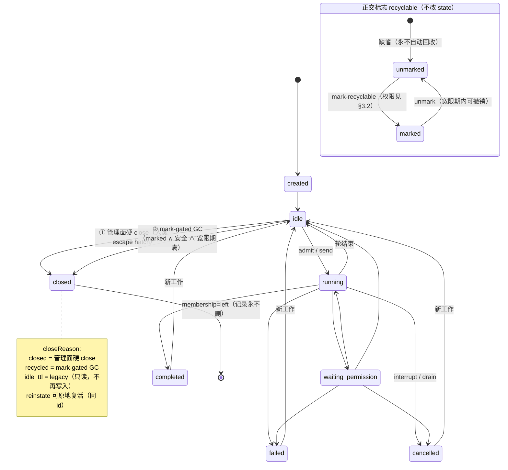

# Agent 生命周期重构设计（mark-gated 回收 + 持久保留）

- 状态：草案（设计中，纯文档，不含代码改动）
- 分支：`design/q-agent-lifecycle`
- 作者：q-agent-lifecycle（parent: main）
- 日期：2026-07-17
- 读者：main / 人类裁决者 / 后续实现者

## 0. 摘要与用户提案（不可违背的四原则）

用户提案原文语义：

1. **所有 agent 都保留**——不因关机 / 重启释放任何 agent；
2. **agent 工具只能中断（interrupt），不能立即清理 agent**；
3. **只能标注「是否可回收」**（mark-recyclable）；
4. **清理由系统自动回收，且只有标注可回收的才能回收**（mark-gated GC）。

本设计在现有代码基础上扩展（非从零建）：`member` / `temporary` 双角色、
`reinstate` 原地复活、durable inbox、`closedAt` / `closeReason` 审计字段全部复用。
核心变更一句话：**把「立即销毁权」从 agent 工具收走，换成「标注权」；把「按 TTL
自动销毁」换成「按标注 + 安全互锁 + 宽限期自动回收」；重启不再释放 temporary。**

## 1. 现状分析（代码事实）

以下锚点均已在分支 `design/q-agent-lifecycle` 的工作树中逐条核对
（行号为撰写时快照，实现时以符号名为准）。

### 1.1 角色与归属

`packages/agent/src/types.ts:55`：`AgentRole = 'member' | 'temporary'`（0.28 收窄为两值）。

| 角色 | 工具入口 | owner | parent | Team | 可见性 | TTL |
| --- | --- | --- | --- | --- | --- | --- |
| `member`（peer） | `agent create` | self（恒等于自身 id） | 无（落盘拒绝） | 必须 | 强制 team | 无，永不自动回收 |
| `temporary`（承包） | `agent hire` | 雇佣者（缺省人类） | 缺省 owner | 可选 | 缺省 team（有 Team）/ private（unbound） | `temporaryTtlHours`，缺省 2h |

- `main` 也是 `member`（`src/agent-service-wiring.ts` `createOrRestoreOwner`）。
- 角色映射：`service.ts:1304`「peer → member（owner=self）；contractor / 无 kind →
  temporary（owner=雇佣者）」。
- Team 内 present 成员上限 `TEAM_MEMBER_LIMIT = 20`（`service.ts:179`，peer +
  contractor 都计入）——持久保留后这是第一个要撞的墙，见 §8.1。

### 1.2 状态机与「释放」的表示

`types.ts:33` `MemberState`：`created / idle / running / waiting_permission /
completed / failed / cancelled / closed / stale(legacy read-only)`。
转移表在 `registry.ts:109` `TRANSITIONS`；`closed` 是吸收态（出边为空）。

「已释放」不是独立状态字段，而是两个持久字段的析取（`service.ts:394`）：

```ts
function isReleased(record) {
  return record.membership === 'left' || record.state === 'closed';
}
```

- `membership: 'present' | 'left'`（持久化）；roster（`agents.list`）只放 present。
- `presence: 'live' | 'gone'`（**进程内，不持久化**）：gone = 需要 resume，不是释放。
- 0.53 起释放审计落盘：`closedAt` / `closeReason`（`registry.ts:104`，
  `types.ts` `PersistedAgentRecord.closed_at / close_reason`）。
- 释放原因两种（`service.ts:388`）：`closed` = 显式 close（人 / 父级 / 批量）；
  `idle_ttl` = sweep 空闲回收。历史视图（`listReleasedMembers`，`includeReleases`）
  只展示记录里写着的事实，未知原因字符串原样保留——**这为新增原因值留好了口子**。
- 记录永不删：「已释放成员的记录永不删」（`registry.ts:101` 注释）；body 记录保留并标
  `retiredAt`，`body_id ≡ session_id` 是续接历史的唯一钥匙（`registry.ts:56`）。

### 1.3 两条释放路径

**路径 A：显式 close**（`service.ts:6319` `close` / `:6355` `closeOne`）

- 批量幂等：`members[]` 逐条 `Promise.allSettled`，重复 close 返回 `{state:'closed'}`，
  单条失败不影响其它条目；gateway `agents.close`（`packages/serve/src/gateway/methods/agents.ts:1345`）
  同语义，team-scoped token 只能关同 team。
- 动作：`disposeAgentBodies`（退役全部 body）→ `state='closed'` + `membership='left'`
  + `presence='gone'` → 写 `closedAt/closeReason='closed'` → 发 `agent.closed` 事件。
- **级联**：owner 被 close 后，其 private temporary 子成员按 registry 原始记录级联
  close（`service.ts:6375-6396`）——这是「立即销毁权」的放大器，重构必须一并收走。
- 权限（`tool.ts:567` `checkPermission`）：owner 调用 / self-close 放行；temporary
  由雇佣者或同 Team 成员放行；**member（含 main）需要人类审批（ask）**，批量含
  member 整体 ask 一次。

**路径 B：sweep 空闲回收**（`service.ts:4374` `sweepIdleTemporaries`）

- 节奏：`clamp(ttl/10, 60s, 15min)`（`service.ts:381/4434`）；定时器只在装配层
  （`src/agent-service-wiring.ts:484-495`，`.unref()`）。TTL=0 关闭。
- 判据读**持久化**字段 `max(record.lastSeen, body.lastActiveAt)`（冷启动后没有内存
  entry 也能触发——这既是优点也是 §1.4 的根因）。
- 只回收 `role==='temporary' && membership==='present'`；member（含 main）永不回收。
- 安全互锁已有雏形：`hasNonIdleWork`（`service.ts:4394`）——在跑轮 / 排队消息 /
  pending / 权限等待一律跳过。
- 动作复用 `reclaimAgent`（`service.ts:4410`）：退役 body + `left/closed` +
  `closeReason='idle_ttl'` + `agent.closed` 事件。**不新增持久字段**。

### 1.4 重启丢全部承包 agent 的根因

关机 / 重启链路（均已核对）：

1. **shutdown drain**（`src/bootstrap.ts:2206-2254`）：fence 准入 → 给有在跑 run 的
   会话写 resume 标记 → `interrupt('shutdown')`。在途 run 被打断，WIP 靠 resume 标记
   与 durable inbox 保全；这一步**没有**释放成员。
2. **loadSnapshot**（`service.ts:1063`）：非 left 成员一律恢复为 `idle + gone`
   （engine 状态进程内易失，`recordFromStatus` `service.ts:711`）。temporary 记录
   **本身是被恢复的**——快照层没有丢。
3. **根因在重启后的第一次 sweep**：判据读的是持久化的
   `max(lastSeen, body.lastActiveAt)`，而**关机时长被计入 TTL**。缺省 TTL=2h，
   只要停机超过 2h（或成员本就空闲超 2h），重启后第一个 sweep tick（≤15min 内）
   就把所有空闲 temporary 判成 `idle_ttl` 回收。对模型侧的表现 = 「本次关机丢全部
   承包 agent」。
4. **复活通道存在但模型够不着**：`reinstate`（`service.ts:6700`）能原地复活
   （同 id、unretire body、清 `closedAt/closeReason`、刷新计时基准），但它「只由
   roster 管理调用」，agent 工具没有入口。于是实践中只能重新 `hire` → 新 id、
   新会话，旧历史挂在已释放记录上不可续接——这就是重雇丢 id/历史的痛点。

结论：**要修的不是快照层（记录本来就在），而是 (a) sweep 的无标注自动销毁权、
(b) 工具层的立即销毁权、(c) 模型侧缺一条「同 id 再激活」的路。**

### 1.5 可复用资产（扩展而非重建的地基）

| 资产 | 锚点 | 在本设计中的用途 |
| --- | --- | --- |
| `reinstate` 原地复活 | `service.ts:6700` | 已释放成员的管理面复活通道，保留不动 |
| 惰性重建 ExecutionUnit | `service.ts:1061` 注释 / admit 路径 | dormant 成员再激活 = 首次 admit 惰性重建，**无需新机制** |
| durable inbox + `recoverPendingInputs` | `service.ts:3783`，`RECOVER_MAX_SESSIONS=8` | 重启后未读消息恢复；GC 互锁要查它 |
| `closedAt/closeReason` additive 审计 | 0.53，`registry.ts:104` | 直接扩展原因值 + 新增标注审计字段 |
| `agent.closed` 事件 + reason | `service.ts:4425` | 回收审计复用，不新增事件类型（标注/撤销除外） |
| `includeReleases` 历史视图 | `service.ts:6779` | 已回收清单的现成展示通道 |
| `hasNonIdleWork` 互锁 | `service.ts:4394` | mark-gated GC 的安全判据基础 |
| `send interrupt:true` | `tool.ts:493` / gateway `agents.send` | 保留为 agent 工具唯一的「停止」手段 |
| bindingHistory / bodies[] 永不删 | `registry.ts:56/66` | 回收后会话历史续接的钥匙 |

## 2. 目标语义与状态机

### 2.1 规范条款（MUST / SHOULD / MUST NOT）

- **M1 持久保留**：关机 / 重启 / drain MUST NOT 释放任何成员（含 temporary）。
  重启后成员以 dormant 形态保留：`membership='present'`、`state='idle'`、
  `presence='gone'`，id / 会话历史 / inbox 全部不变。
- **M2 工具无销毁权**：agent 工具 MUST NOT 提供任何立即销毁成员的入口。
  `agent close` 动作替换为 `mark-recyclable`；级联 close 一并废除（§3.1）。
- **M3 中断保留**：`agent send interrupt:true` 是 agent 工具唯一的「停止」手段：
  取消目标活动 run、保全 WIP（resume 标记 + durable inbox），不改 membership。
- **M4 标注正交**：`recyclable` 是持久化布尔标志 + 审计三元组，**不是新状态**；
  标注 / 撤销不改 `state / membership / presence`，不发终态通知。
- **M5 mark-gated GC**：系统 sweep MUST 只回收 `recyclable===true` 且通过安全互锁
  （§4.2）且宽限期已满（§4.3）的成员。未标注成员 MUST NOT 被自动回收——
  **TTL 到期不再是回收理由**。
- **M6 审批不降级**：标注 peer（`role='member'`，含 main）MUST 走人类审批（ask）；
  标注 main / 调用者自身 MUST 拒绝（保护名单，§4.5）。GC 执行已获批标注时不再
  二次审批（审批点在标注，见 §3.2 裁决）。
- **M7 可撤销**：宽限期内任何有权限的主体可 `unmark` 撤销标注；撤销即退出待回收
  清单，GC 永不回收。已回收成员走 `reinstate` 复活（同 id）。
- **M8 审计完整**：标注（谁 / 何时 / 为何）与回收（时刻 / 原因）MUST 落盘并进
  事件流；历史视图原样展示，不按白名单改写（沿用 0.53 口径）。

### 2.2 关键设计决策：recyclable 是正交标志，不是新状态

**决策**：不新增 `MemberState` 值（不加 `dormant` / `recyclable` / `recycled` 状态），
只新增持久化标志字段。理由：

1. `MemberState` 表达的是**执行相位**（created→idle→running→…→终态），由
   `updateAgentState` 从 ExecutionUnit 聚合推导（`service.ts:4319`）。把「可回收」
   塞进状态机会让推导逻辑分叉：一个 idle 成员可能同时可回收 / 不可回收，状态机
   无法表达这种正交性，除非状态数乘积爆炸（`idle_recyclable` / `completed_recyclable`…）。
2. `TRANSITIONS`（`registry.ts:109`）是封闭表，新增状态要改全部转移边与
   `canTransition` 调用点；正交标志零侵入。
3. 现有「释放」本来就是 `membership + state` 的析取投影（§1.2），不是状态枚举值——
   沿用同一风格：**回收 = `left/closed` + `closeReason='recycled'`**，
   **dormant = `present + idle + gone`**，都是投影，不是新状态。
4. 快照兼容：additive 字段旧快照读作缺省（`recyclable` 缺省 false），
   `snapshot.ts` 的「绝不在 parse 阶段 reject」铁律自然满足。

新增持久字段（`MemberRecord` / `PersistedAgentRecord`，全部 additive）：

```ts
// registry.ts MemberRecord（camelCase）
recyclable?: boolean;      // 缺省 undefined ≡ false：未标注 = 永不自动回收
markedBy?: string;         // 标注者 principal（agent id / 'human' / 'system'）
markedAt?: number;         // 标注时刻（宽限期计时基准）
markReason?: string;       // 标注理由（必填，单行截断 500 字符，同闸原因口径）

// types.ts PersistedAgentRecord（snake_case 落盘）
recyclable?: boolean;
marked_by?: string;
marked_at?: number;
mark_reason?: string;
```

`recyclable` 缺省 false 是**安全缺省**：旧快照 / 迁移期成员一律不可自动回收，
宁可 roster 增长也不误杀（§8.1 的墙用显式标注 + GC 疏解，不用缺省 true）。

### 2.3 状态机图

执行相位状态机**不变**（沿用 `TRANSITIONS`）；标注是正交维度，回收是释放投影：



要点：

- 图中 ② 只从 `idle` 出发是简化：GC 的安全互锁（§4.2）保证回收时刻成员必然
  无在途工作，聚合态必为 idle / 终态之一；终态成员同样可被回收（先经
  `updateAgentState` 归 idle 或直接按终态处理，实现时统一走 `reclaimAgent`）。
- `running / waiting_permission` 成员**可以被标注**（标注不打断），但 GC 会一直
  跳过直到安全；需要立刻停下时先 `interrupt` 保全再等 GC——这正是用户提案
  「先 interrupt 保全再标注」的操作序。
- `stale` 保持 legacy read-only，不新增写入者。

### 2.4 dormant 语义与再激活（同 id，非重雇）

- **dormant 不是新状态**：= `present + idle + presence:'gone'`。重启后所有成员
  （含 temporary）都以此形态恢复（`loadSnapshot` 现有行为，§1.4 第 2 步），
  本设计只是**不再让随后的 sweep 把它们销毁**。
- **再激活 = 首次 admit 惰性重建 ExecutionUnit**（现有机制，`service.ts:1061`）：
  任何 `agent send` / 人类投递到 dormant 成员 → admit → `ensureExecutionUnit`
  重建 runtime → 同一 `binding_id ≡ session_id` 续接会话历史。**id 稳定，
  无需重新 hire，无需新 API。**
- 已释放（`left/closed`）成员的复活仍走 `reinstate`（管理面 / roster 通道，
  同 id unretire）。本设计不新增模型侧复活入口：GC 回收的成员若需复活，
  由人类 / roster 管理操作——避免模型绕过标注语义私自「复活再回收」打转。
- 重启恢复的 spawn 成本仍由 `RECOVER_MAX_SESSIONS=8` 封顶（`service.ts:349`）：
  dormant 保留是**记录级**的，不是一开机全部拉起；超出顺延下次启动。

### 2.5 释放原因扩展与审计轨迹

`closeReason` 值域扩展（历史视图原样展示，无需白名单改动）：

| reason | 写入者 | 语义 |
| --- | --- | --- |
| `closed` | 管理面硬 close（人类 RPC，保留） | 显式立即关闭（escape hatch，§3.3） |
| `recycled` | mark-gated GC（新） | 已标注 + 安全 + 宽限期满，系统自动回收 |
| `idle_ttl` | **不再写入**（legacy 只读） | 旧 sweep 回收；存量记录原样保留 |

审计轨迹两段式：

1. **标注段**：`markedBy / markedAt / markReason` 落盘 + 新事件
   `agent.marked_recyclable`（撤销发 `agent.unmarked`，清四个字段）。
2. **回收段**：复用 `closedAt / closeReason='recycled'` + `agent.closed` 事件
   （reason 携带 `recycled`，可附 `marked_by` 供看板展示「谁标注的」）。

`reinstate` 复活时清标注四字段（与现有清 `closedAt/closeReason` 同一位置，
`service.ts:6742`）：复活 = 回到未标注缺省，防止「复活即又被回收」。

## 3. API 变更

（待扩充：agent 工具 close→mark-recyclable、interrupt 保留、权限矩阵、RPC 变更、service 层）

## 4. GC 策略（mark-gated）

（待扩充：sweep 改造、安全互锁、宽限期、可选自动标注、保护名单、回收动作）

## 5. 重启持久化

（待扩充：快照 additive 字段、loadSnapshot 变更、再激活路径、shutdown drain）

## 6. 可见性

（待扩充：roster / 看板 recyclable 标志、待回收清单、事件与审计）

## 7. 迁移计划

（待扩充：分阶段落地、旧快照 / 旧配置兼容、回滚策略）

## 8. 风险与权衡

（待扩充：roster 增长与 TEAM_MEMBER_LIMIT、误标注、磁盘泄漏、兼容风险）

## 9. 决策记录与开放问题

（待扩充）

## 附录 A：代码锚点表

（待扩充）